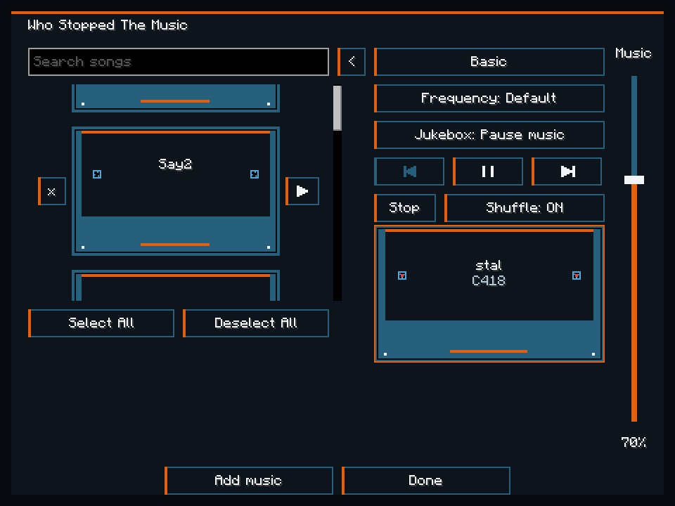
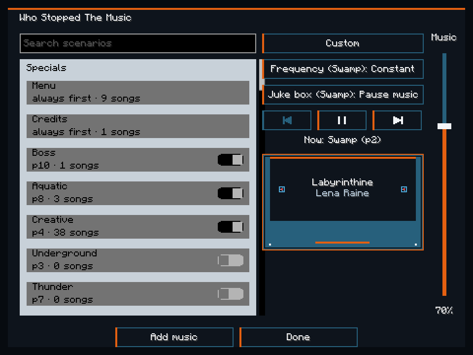
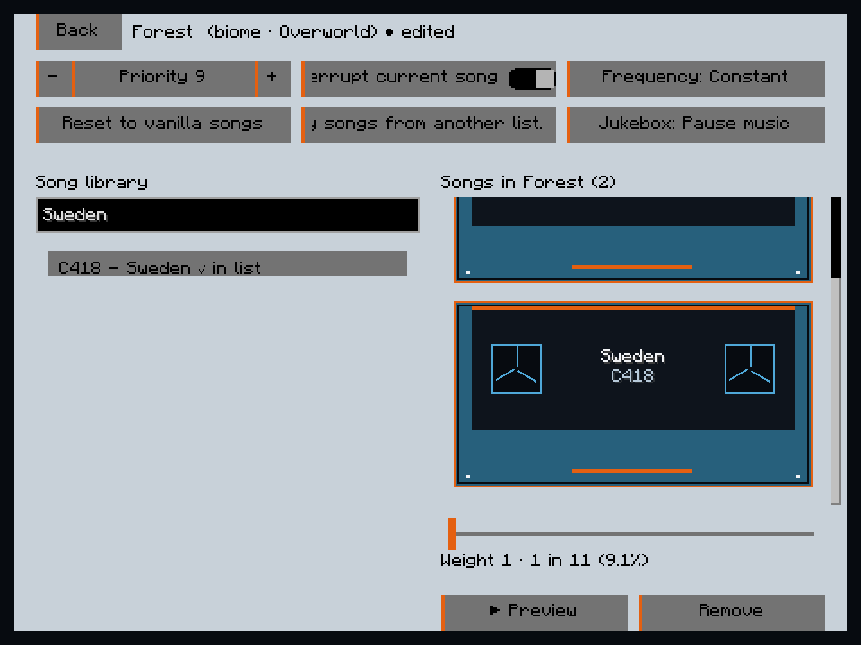
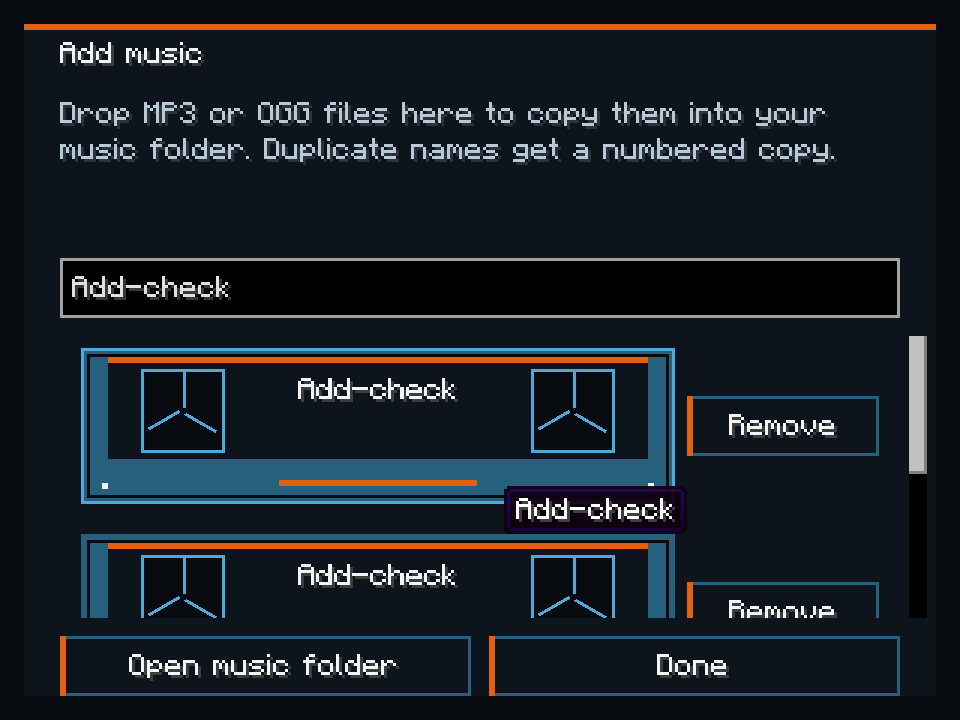

# Who Stopped The Music

Choose what Minecraft plays without replacing its music player. Keep vanilla's choices, make one song list for the whole game, or give each biome and situation its own soundtrack. Music discs and your own MP3 and OGG files work as background music too.

Press **M** in a world, or click the cassette at the top of the pause menu. The mode button cycles **Vanilla → Basic → Custom**. M can be rebound in Controls → Who Stopped The Music.

## One list, everywhere

**Basic** plays your selected songs across biomes, dimensions and the title screen. For example, select Sweden and Pigstep and those are the songs you get, even when you leave the Overworld.

Tick songs to include them, or press a row's Play button to hear it immediately. Search by title or artist; hide the browser with the inward arrow when you only want the player. Previous and Next use your playback history. Shuffle off plays the selected list in order; Shuffle on draws without replacement before refilling. Stop holds silence until Play, Next or a row's Play, or a game restart. An empty selection stays silent.

**Vanilla** keeps Minecraft's song selection and offers Play, Pause/Resume and Next. In every mode, Pause/Resume keeps the current song's position. The Music slider changes only background music; Master and Music Toast stay in Minecraft's sound options.

## Music for each place

**Custom** lists specials first, then the biomes from the world you joined, including modded and datapack biomes. Open Forest to choose its songs, or enable Thunder and give storms their own soundtrack.

The highest-priority active scenario wins. Equal priorities combine song lists and add the weights of shared songs. An active winner with no songs means silence; turning a special off lets another scenario take over. Underground and weather specials start off, so enabling them is your choice.

Drag a song from the library into the right-hand list. Focus a cassette to change its weight from 1–100, preview up to three seconds from its midpoint, or remove it. Preview pauses background music and then resumes the same song. Reset restores only the songs; Copy songs replaces only the songs and weights, leaving that scenario's other settings alone.

On the main Custom screen, Frequency and Jukebox name the current winning scenarios and edit those scenarios together. Right-click either setting and confirm Yes to apply its current value to every scenario, including biomes discovered later.

## Bring your own songs

Choose **Add music** in Basic or Custom. Drop regular `.mp3` or `.ogg` files onto that screen, then confirm the copy. Existing files stay intact; duplicate names get numbered copies. **Open music folder** opens the instance's `music/` directory, where you can also place files yourself.

Your Songs appears in Basic and in the Custom editor's library. Filenames supply the titles. Remove on the Add music screen permanently deletes that local copy after confirmation; Remove in a scenario editor only removes the entry from that list. Broken files show Can't play. Missing scenario entries keep their settings and are skipped until the file returns.

Music Frequency starts at **Constant** on first launch. You can change it in the screen; Custom keeps its own frequency per scenario. **Pause music** holds background music while a jukebox plays within 64 blocks; **Play over** lets both play. Transport never stops the jukebox itself.

## Install

Use the 1.2.0 jar in a **Minecraft 26.3 Fabric** instance with **Java 25**, **Fabric Loader 0.19.5 or newer** and **Fabric API 0.162.0+26.3 or newer for 26.3**. Put the mod and Fabric API in that instance's `mods/` folder. The MP3 decoder is bundled.

Install on your client for singleplayer or multiplayer. Servers don't need the mod.

See the [configuration guide](docs/CONFIGURATION.md) for defaults, scenario conditions, file examples and v1 settings compatibility. The [changelog](CHANGELOG.md) records the rebuild's player-facing changes. Contributor build instructions and ownership live in [the architecture](docs/ARCHITECTURE.md); implementation evidence and remaining acceptance are in [the sole 1.2.0 plan](docs/plans/1.2.0.md).

Our code is CC0-1.0. The unmodified bundled JLayer decoder retains its [LGPL 2.1 license](LICENSE_jlayer).
