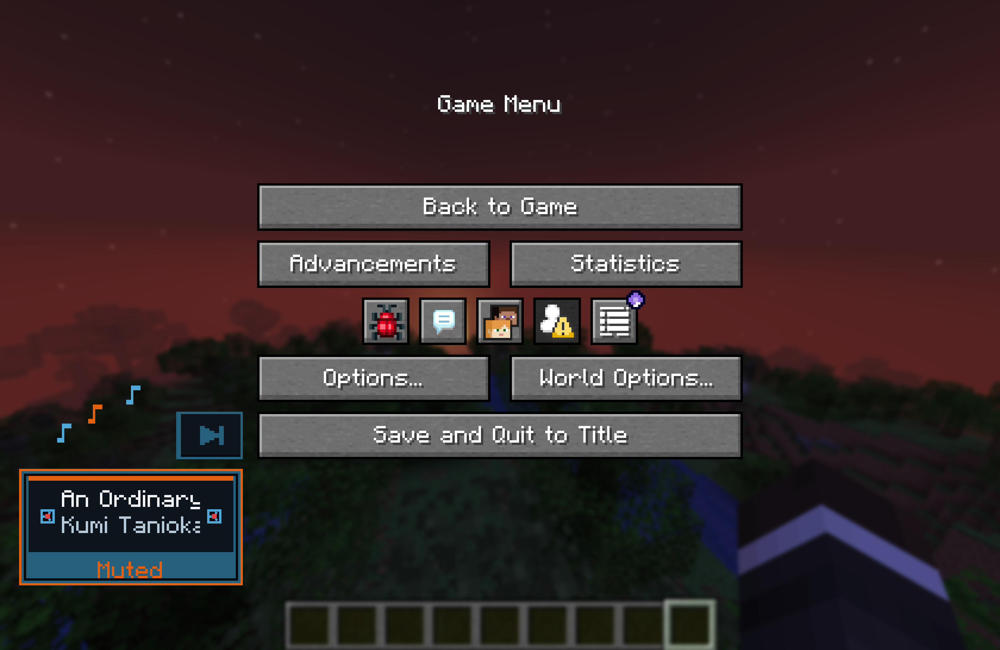
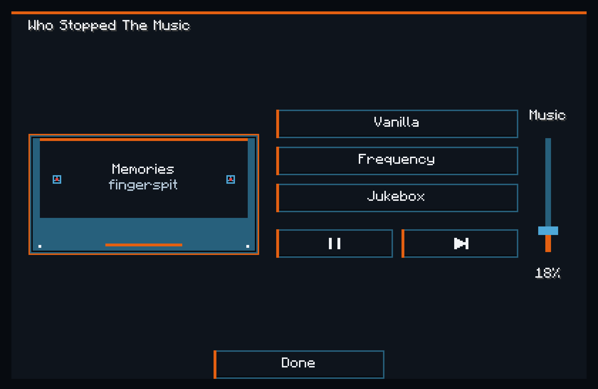
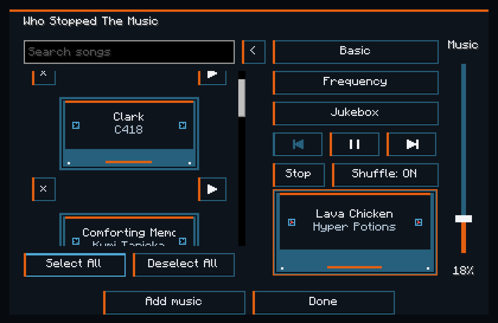
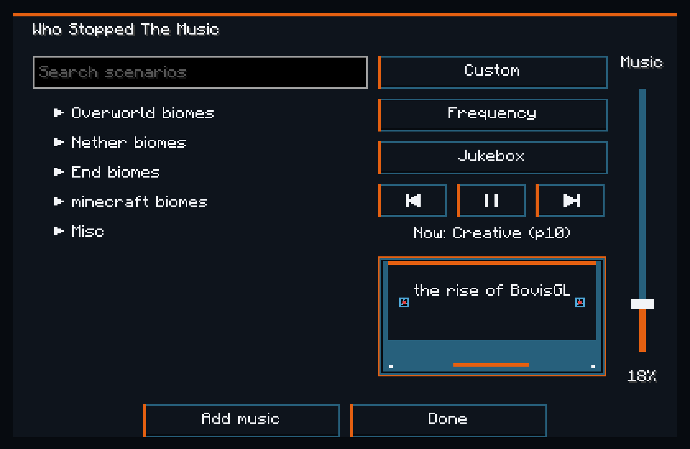
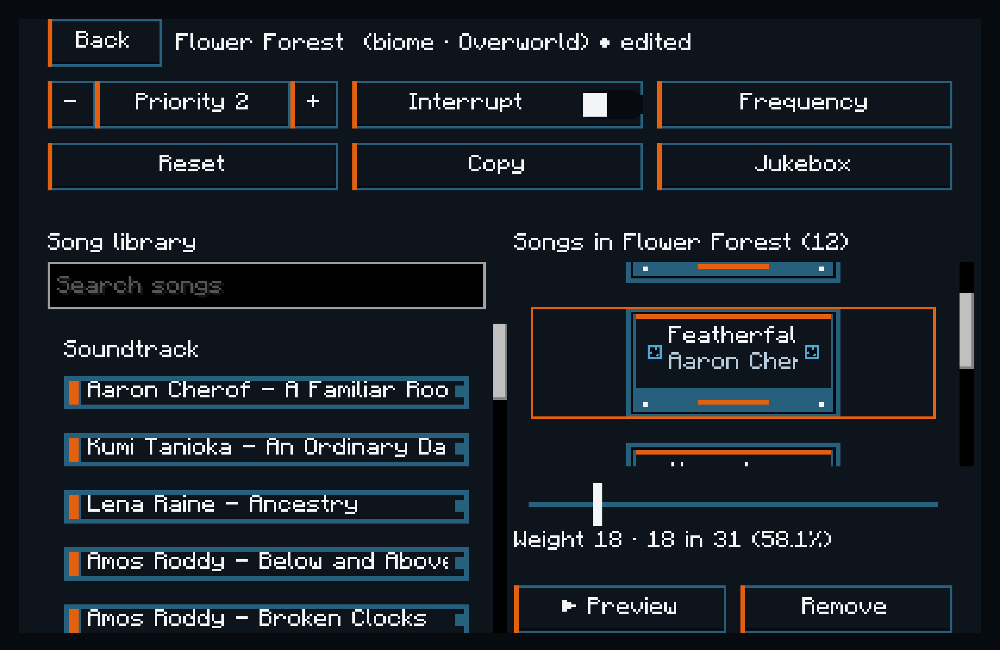
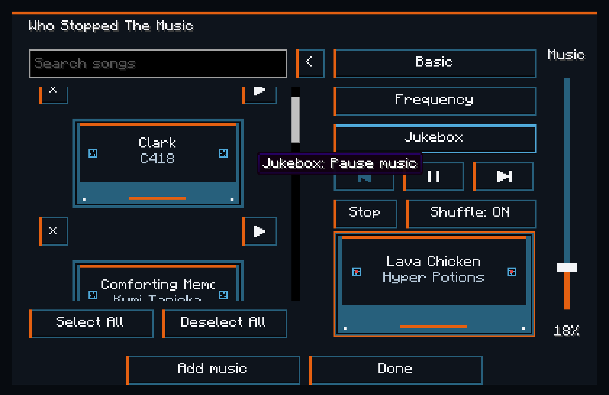
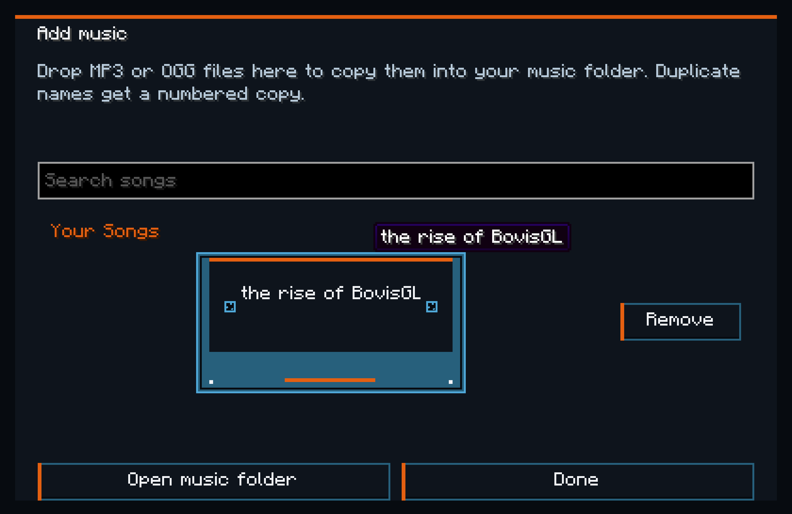

# Who Stopped The Music

Who Stopped The Music is a full soundtrack editor for Minecraft 26.3. Choose what music plays and when, using the game's soundtrack, music discs, or your own MP3 and OGG files.

Keep Minecraft's usual music choices with a few extra controls, build one playlist for the whole game, or give each biome and situation its own soundtrack.

Press **M (rebindable)** to open the editor, or click the cassette in the bottom-left corner of the title or pause menu. Change the key in **Controls → Who Stopped The Music**. Click the mode button to switch between **Vanilla**, **Basic** and **Custom**.

*The music controls have moved in. Bottom-left, rent-free.*

## Vanilla mode

Vanilla mode leaves Minecraft's process for choosing songs intact, so the music you hear is still picked for the same places and situations as the base game.

You can start music, pause and resume the current song, or skip it and let Minecraft choose another. You also get controls for music volume, how often songs play, and whether a nearby jukebox pauses background music or plays alongside it.

*Minecraft still picks the songs. You just get a skip button.*

## Basic mode

Basic mode gives you one music pool for the whole game, including the title screen and every dimension. Select the songs you want from the soundtrack, music discs and your imported files; those are the songs that play wherever you go.

Search by song or artist, select individual tracks, or use **Select All** and remove the ones you don't want. Turn Shuffle on for shuffled playback, or off to play your selection in order.

Basic includes the same volume, frequency and jukebox settings as Vanilla, along with Previous, Next and Stop controls. You can also play a song directly from the browser without adding it to your selection.

*Pigstep in the Overworld? Your playlist, your rules.*

## Custom mode

Custom mode opens a scenario-based soundtrack editor. Give a flower forest a peaceful playlist, choose something heavier for thunderstorms, or replace the menu music with your own song.

Biomes come from the world's biome registry, so modded and datapack biomes can appear too. Join a world to load its biome list, then expand a group or search for the biome you want.

Alongside biomes, the **Misc** section includes:

- **Menu:** while you're outside a world.
- **Credits:** while the credits are showing.
- **Boss:** when Minecraft requests boss music, normally during the Ender Dragon fight.
- **Aquatic:** while you're underwater in an ocean or river biome.
- **Creative:** while you're in Creative mode.
- **Underground:** below your chosen Y level, without a view of the sky.
- **Thunder:** during thunderstorms where the biome has precipitation.
- **Rain:** where it's raining.
- **Snow:** where it's snowing.

*Every biome gets a say. Some just get a louder say.*

Open a scenario, then drag songs from the library into its music list. Each song has its own weight, so you can make favourites more likely without removing the rest.

*Featherfall has been promoted to forest management.*

## Settings and controls

### Playback and volume

**Play** starts music when nothing is playing. **Pause** holds the current song's position, and **Resume** continues from there.

**Next** moves to another song; in Vanilla mode, Minecraft chooses it for the current situation. **Previous** is available in Basic and Custom and returns through your playback history.

Basic mode also has **Stop**, which keeps the music silent until you start it again or restart the game.

The **Music** slider controls the same Music volume setting as Minecraft's own sound options; it isn't a separate volume control stacked on top. It changes background music without changing sound effects or jukebox volume. Minecraft's **Music Toast** setting controls the song-change notification, including notifications for imported songs.

### Frequency

Frequency controls the gap between songs:

- **Default** uses Minecraft's normal music delays.
- **Frequent** shortens the wait.
- **Constant** removes the usual wait between songs.

Changing Frequency doesn't cut off the song already playing. The mod starts with **Constant** selected.

Vanilla and Basic use Minecraft's global frequency setting. Custom lets each scenario have its own.

### Jukebox

Choose **Pause music** to hold background music while a jukebox plays within 64 blocks, or **Play over** to let both play together. These controls don't stop the jukebox itself.

Custom can use a different jukebox setting for each scenario.

*One song at a time. Unless you specifically asked for two.*

### Scenario settings

**Active** enables or disables a Misc scenario. Weather and Underground start disabled, so you can add their songs before switching them on. Biome scenarios are always on and have no Active toggle. Menu and Credits always apply on their respective screens.

**Priority** decides which scenario wins when several apply. Higher numbers win; equal priorities combine their song lists, adding the weights of shared songs. Menu and Credits take precedence on their screens. An empty winning list means silence, so disable an unwanted scenario rather than emptying it if you want another scenario to take over.

**Interrupt** lets a newly winning scenario replace the current song immediately. With it off, the outgoing song can finish first.

**Outside** makes a weather scenario require exposure to the weather. Turn it off if you want that weather's soundtrack while sheltered too.

**Y level** sets Underground's upper boundary. With 64 selected, you must be below Y64 and unable to see the sky.

**Weight** controls how often a song appears in the shuffled pool, from 1–100. A song with weight 20 gets twice as many entries as one with weight 10. Each entry is used once before the pool refills, so a song with multiple entries can repeat before every other song has played. The editor shows each song's share of that list's total weight.

**Preview** plays up to three seconds from the middle of a song, then resumes your background music.

**Reset** restores the scenario's default songs. **Copy** replaces its songs and weights with those from another scenario. Neither changes its other settings.

Frequency and Jukebox on the main Custom screen affect the currently winning scenarios. Right-click either control and confirm to apply its displayed value to every scenario, including biomes discovered later.

## Bring your own music

Click **Add music** in Basic or Custom, drop MP3 or OGG files onto the screen, then confirm the copy. Your originals stay where they are, and duplicate filenames get numbered copies.

You can also click **Open music folder** and put files directly in that instance's `music/` folder. Your files appear under **Your Songs**, ready to add to Basic's pool or any Custom scenario.

Removing a song from a scenario only removes that list entry. Removing it from the Add music screen permanently deletes the imported local copy after confirmation.

*The soundtrack committee is now accepting submissions.*

## Installation

For **Minecraft 26.3**, use **Java 25+**, **Fabric Loader 0.19.5+** and **Fabric API 0.162.0+26.3** or a later compatible version.

Put Who Stopped The Music and Fabric API in your Fabric instance's `mods` folder, then launch the game.

This is a **client-only mod** for singleplayer and multiplayer. Servers don't need it installed. MP3 support is bundled.

## Made by PyreHaven

Made by [PyreHaven](https://pyrehaven.xyz).

[Source code on GitHub](https://github.com/ff-tech-xyz/whostoppedthemusic)

---

[Configuration reference](docs/CONFIGURATION.md) · [Changelog](CHANGELOG.md) · [Architecture and build instructions](docs/ARCHITECTURE.md)

Our code is CC0-1.0. The unmodified bundled JLayer decoder retains its [LGPL 2.1 license](LICENSE_jlayer).
